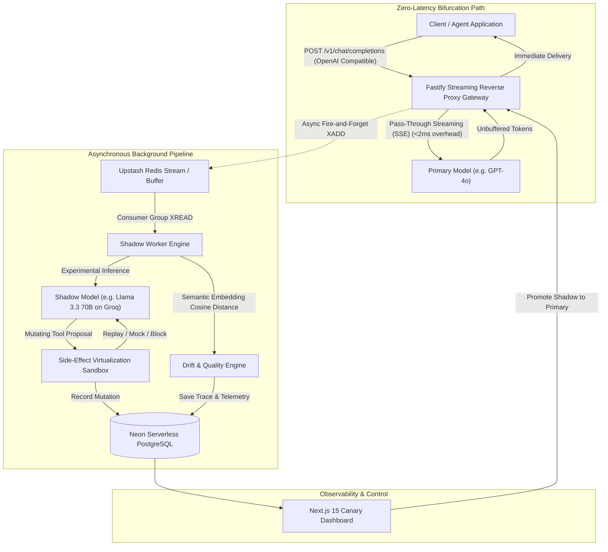

# ShadowLLM // Production AI Shadow-Testing & Live Drift Engine

> **High-throughput drop-in reverse proxy that bifurcates production LLM traffic to test experimental models and prompts with zero-latency streaming pass-through, side-effect virtualization, and live semantic drift detection.**

[](LICENSE)
[](https://nodejs.org)
[](https://fastify.io)
[](https://nextjs.org)
[](#100-free-tier-architecture)

---

## ⚡ The Architecture at a Glance



---

## 🚀 Why ShadowLLM? (The Production Problem)

Deploying a smaller, cheaper, or fine-tuned LLM (e.g. switching from **GPT-4o** to **Llama 3.3 70B** or **Gemini 2.0 Flash**) can cut inference bills by **80%–90%** and slash p95 latencies. 

However, testing models in production presents three catastrophic failure modes:

1. **Double-Mutation Disasters (Side-Effects)**: If an autonomous AI agent executes a tool call like `execute_payout`, `charge_card`, or `delete_record`, a naive shadow copy will execute that tool a second time—charging customers twice or corrupting records.
2. **Streaming Latency Penalties**: Traditional interceptors buffer LLM responses before cloning, ruining client Time-To-First-Token (TTFT) and degrading user experience.
3. **Silent Semantic Drift**: LLM outputs diverge non-deterministically. Without continuous embedding cosine distance and argument schema compliance scoring, quality regressions slip undetected into production.

**ShadowLLM solves all three problems in a single, drop-in binary.**

---

## 🧱 The 4 Core Engineering Pillars

### 1. Zero-Latency Bifurcation Gateway
- **Drop-in OpenAI Compatibility**: Exposes `POST /v1/chat/completions` and `GET /v1/models`.
- **Zero Buffering Overhead**: Passes streaming Server-Sent Events (`text/event-stream`) straight through to the client without waiting for completion. Adds **under 2 milliseconds** of proxy overhead.
- **Asynchronous Payload Cloner**: Captures input prompts, model parameters, and stream chunks, enqueuing them to an Upstash Redis Stream via non-blocking fire-and-forget execution.

### 2. Side-Effect Virtualization Sandbox
- **Automated Tool Classification**: Categorizes tool schemas into `READ_ONLY` (e.g. `search_docs`, `get_balance`) vs `SIDE_EFFECT` (e.g. `charge_card`, `execute_payout`, `update_order`).
- **Zero Double-Mutation Guarantee**:
  - Intercepts proposed mutating actions from the shadow model.
  - Compares arguments against what the primary model actually executed.
  - **Replays** the primary model's observed tool response back into the shadow model's context or generates safe dry-run mocks.
  - Allows the shadow model to complete its multi-turn reasoning loop with **zero duplicate real-world side effects**.

### 3. Live Semantic Drift & Quality Engine
- **Embedding Cosine Similarity**: Compares primary and shadow outputs in dense vector space:
  $$\text{Cosine}(A, B) = \frac{A \cdot B}{\|A\| \|B\|}$$
- **Multi-Provider Support**: Uses Google AI Studio (`text-embedding-004`), OpenAI (`text-embedding-3-small`), or the built-in deterministic n-gram vectorizer for 100% offline environments.
- **Automated Drift Breaches**: Automatically flags traces whenever similarity falls below the configurable threshold (default `0.85`) or tool call arguments diverge.

### 4. Real-Time Canary Operations Dashboard
- Built with **Next.js 15 (App Router)** and **Tailwind CSS** in a dark monotone developer aesthetic.
- **Live Cost Savings Counter**: Real-time odometer displaying total dollars saved and percentage cost reduction.
- **P95 Latency Delta**: Highlights p50 and p95 speedups between models.
- **Side-by-Side Diff Inspector**: Inspects prompts, token counts, and token-level output differences.
- **One-Click Promotion**: Switch the shadow model to become production primary with zero downtime.

---

## 💰 100% Free-Tier Architecture ($0.00 / month)

| Service | Role | Free Tier Capacity | Fallback / Local Offline |
| :--- | :--- | :--- | :--- |
| **Neon** | Serverless PostgreSQL | 0.5 GiB storage, pooling | Built-in in-memory DB adapter |
| **Upstash** | Redis Stream Queue | 10,000 commands / day | Built-in zero-dependency memory buffer |
| **Groq Cloud** | Shadow Inference (Llama 3.3 70B) | 30 RPM, 14,400 RPD | Built-in deterministic mock responder |
| **Google AI Studio** | Semantic Embeddings (`text-embedding-004`) | 1,500 RPD free | Built-in deterministic 3-gram vectorizer |
| **Render** | Docker Proxy Gateway & Worker | 750 free instance hrs / mo | Local Node.js process / Docker |
| **Vercel** | Next.js 15 Canary Dashboard | Free hobby tier | `localhost:3000` |

---

## 🔐 Secrets & Environment Audit

| Environment Variable | Service | Required? | Free Tier Source | Mock / Offline Fallback |
| :--- | :--- | :--- | :--- | :--- |
| `DATABASE_URL` | Neon Postgres | Optional | [neon.tech](https://neon.tech) | In-Memory Database |
| `UPSTASH_REDIS_REST_URL` | Upstash Redis | Optional | [upstash.com](https://upstash.com) | In-Memory Stream Queue |
| `UPSTASH_REDIS_REST_TOKEN` | Upstash Redis | Optional | [upstash.com](https://upstash.com) | In-Memory Stream Queue |
| `PRIMARY_API_KEY` | Primary LLM Provider | Optional | OpenAI / Anthropic | Built-in Mock LLM |
| `SHADOW_API_KEY` | Shadow LLM Provider | Optional | [console.groq.com](https://console.groq.com) | Built-in Mock LLM |
| `EMBEDDING_API_KEY` | Embeddings | Optional | [aistudio.google.com](https://aistudio.google.com) | Built-in Vectorizer |
| `PROXY_AUTH_TOKEN` | Proxy Auth Header | Optional | Self-generated | Disabled if blank |

---

## 🛠️ Quickstart

### 1. Clone & Install
```bash
git clone https://github.com/shivam/shadow-llm-proxy.git
cd shadow-llm-proxy
npm install
```

### 2. Configure Environment (Optional for Offline Dev)
```bash
cp .env.example .env
```
*(The system boots into 100% offline mock mode if no environment variables are set!)*

### 3. Seed Realistic Trace Data
```bash
npm run seed
```
Seeds 20 realistic trace pairs, including high-similarity matches, semantic drift warnings, and side-effect virtualized tool mutations.

### 4. Run the Full Suite
In separate terminal windows:
```bash
# Terminal 1: Proxy Gateway & Embedded Worker
npm run dev:server

# Terminal 2: Canary Dashboard UI
npm run dev:dashboard
```

Visit the Canary Dashboard at **[http://localhost:3000](http://localhost:3000)**!

---

## 🧪 Verification & Automated Testing

Run the full end-to-end test suite across all packages:

```bash
npm test
```

### Run High-Concurrency Load & Overhead Benchmark:
```bash
npm run test:load
```
*Measures proxy gateway throughput, concurrency, and sub-2ms bifurcation pass-through latency.*

### Test an OpenAI API Call through the Proxy:
```bash
curl -X POST http://localhost:8080/v1/chat/completions \
  -H "Content-Type: application/json" \
  -d '{
    "model": "gpt-4o",
    "stream": true,
    "messages": [{"role": "user", "content": "Explain zero-latency request bifurcation."}]
  }'
```

---

## 📂 Project Structure

```
shadow-llm-proxy/
├── apps/
│   ├── dashboard/          # Next.js 15 Canary Dashboard & Diff Inspector
│   │   ├── app/            # App router, telemetry UI, radar chart, diff viewer
│   │   └── tailwind.config.ts
│   ├── server/             # Fastify Streaming Reverse Proxy Gateway
│   │   ├── src/proxy.ts    # Zero-latency streaming bifurcator
│   │   └── src/index.ts    # OpenAI-compatible API routes & canary controls
│   └── worker/             # Shadow execution & Side-effect sandbox
│       ├── src/sandbox.ts  # Mutating tool interceptor & argument differ
│       └── src/worker.ts   # Stream consumer & drift evaluation trigger
├── packages/
│   └── shared/             # Domain models, pricing engine, db & queue adapters
│       ├── src/db.ts       # PostgreSQL & in-memory dual database adapter
│       ├── src/eval.ts     # Cosine similarity & semantic drift engine
│       ├── src/pricing.ts  # Token cost calculation matrix
│       ├── src/queue.ts    # Redis Streams & memory buffer queue
│       └── src/seed.ts     # 20 realistic evaluation trace pairs
├── scripts/
│   └── load-test.ts        # Throughput & sub-2ms overhead benchmark
├── Dockerfile              # Multi-stage production container for Render
├── render.yaml             # Render Free Web Service deployment spec
```
